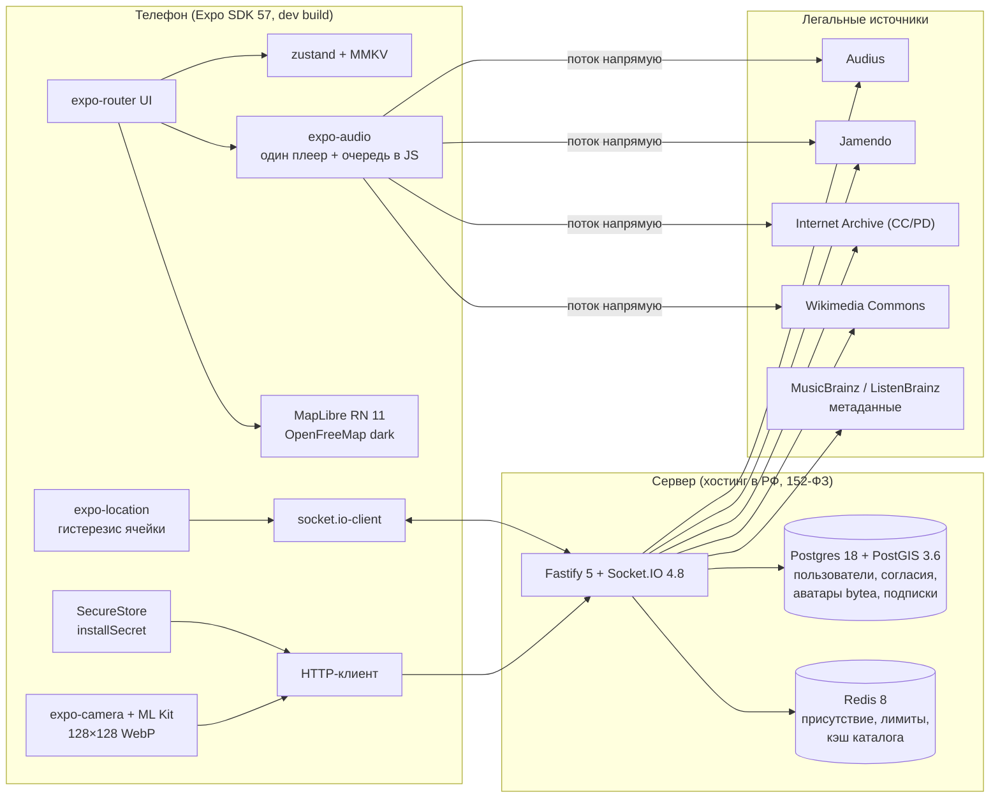

# МУЗРАДАР — техническая архитектура

Состояние на 2026-09-16. Версии и API проверены по живым реестрам, исходникам пакетов и документации.

## Общая схема



## Мобильное приложение

| Слой | Решение | Почему |
|---|---|---|
| Платформа | Expo SDK 57, React Native 0.86.3, React 19.2.3, TypeScript 6.0, New Architecture, dev build (не Expo Go) | Версии, которые фиксирует сам SDK; нативные модули требуют dev build |
| Навигация | expo-router 57: `Stack.Protected` на корне (онбординг ↔ приложение) и на каждом шаге онбординга | Guard, который нельзя обойти диплинком; типизированные маршруты |
| Состояние | zustand 5 + `persist` поверх react-native-mmkv 4 (синхронно) | Состояние есть уже на первом рендере: вернувшийся пользователь сразу видит карту, онбординг не мелькает |
| Серверные данные | TanStack Query 5 | Кэш и ретраи для каталога и профиля |
| Секрет устройства | expo-secure-store, `AFTER_FIRST_UNLOCK_THIS_DEVICE_ONLY` | Читается фоновыми задачами при заблокированном экране; в iOS переживает переустановку |
| Музыка | expo-audio 57: **один** `createAudioPlayer` на уровне модуля, очередь в JS, `setActiveForLockScreen` один раз за сессию | react-native-track-player 4 не работает на New Architecture; хуки плеера освобождают его при размонтировании дерева в фоне |
| Карта | @maplibre/maplibre-react-native 11.3.10, стиль OpenFreeMap `dark` (без ключа), перекрашенный под бренд | Нативная кластеризация, GPU-слои на тысячи точек, нет платного ключа |
| Точки на карте | Один `GeoJSONSource` (cluster) + `<Layer type="symbol">` с аватаром и названием трека; `Marker` — только для своей точки | Один `Marker` на пользователя — это нативный View, не масштабируется |
| Геолокация | expo-location: только foreground-разрешение; `watchPositionAsync`, пока приложение открыто; гистерезис ячейки на устройстве | Координаты не покидают телефон; Google Play не требует декларации фоновой геолокации |
| Live-режим (фаза 2) | `startLocationUpdatesAsync` + foreground service `location`, включается флагом `LIVE_LOCATION` | Позиция в фоне без `ACCESS_BACKGROUND_LOCATION`; нужна отдельная декларация в Play |
| Аватар | expo-camera (фронтальная, зеркало) → нормализация до 720 px → ML Kit (@infinitered/react-native-mlkit-face-detection 5) → кроп → 128×128 WebP q0.6 | ≈1,5 КБ; лицо проверяется на устройстве и нигде не распознаётся |
| Галерея | Нет зависимостей и нет разрешений; `android.blockedPermissions` вырезает то, что подмешивают библиотеки; сборка проверяется скриптом | Требование «только камера» |
| Шрифты | Unbounded (заголовки) + Manrope (текст), оба с кириллицей | Характер бренда |

## Backend

| Компонент | Решение |
|---|---|
| HTTP | Fastify 5.12 + fastify-type-provider-zod 7 (схемы из `@muzradar/shared`) |
| Аутентификация | `POST /v1/auth/device`: `installSecret` → JWT на 15 минут (`@fastify/jwt`, HS256) с claims `{sub, did, ob}`. Сервер хранит только sha256 секрета. Android: восстановление после переустановки по HMAC(pepper, Android ID) |
| Онбординг на сервере | Карта, музыка и сокет закрыты, пока `ob=false`: онбординг нельзя обойти даже модифицированным клиентом |
| IP | Только антифрод и лимиты (`@fastify/rate-limit`, ключ — пользователь или IP). Никогда не используется для опознания |
| Реалтайм | Socket.IO 4.8, свой плагин (preClose/onClose), только websocket (без sticky-сессий), `connectionStateRecovery` на 2 минуты |
| Мульти-нода | `@socket.io/redis-streams-adapter` на ioredis 6 (`protocol: 2`) — включается при `REDIS_URL` и больше чем одной ноде |
| БД | Postgres 18 + PostGIS 3.6, drizzle-orm 0.45 (свой тип `geometry(Point,4326)`), миграции drizzle-kit |
| Dev без Docker | Если `DATABASE_URL` не задан — в процессе поднимается PGlite 0.5 за Postgres-протоколом (127.0.0.1:54329). Код всегда работает через `pg`, как в продакшене. PostGIS (`@electric-sql/pglite-postgis`) подключается миграцией в фазе 2 вместе с локационными плейлистами: в фазе 0 геозапросов к БД нет, а расширение замедляет холодный старт на ~25 с |
| Присутствие | Интерфейс `PresenceStore`: `Memory` (dev, тесты, одна нода) и `Redis` (GEO + ZSET lastSeen + hash с EXPIRE + чистильщик на Lua под лидер-локом) |
| Аватары | `sharp` перекодирует в WebP 128×128 (метаданные стираются) и хранит `bytea` в Postgres с адресацией по sha256. Отдельно генерируется круглая версия для карты 96×96 с альфой. Раздача с `Cache-Control: immutable`, в продакшене через CDN |

### Размытие позиции

1. Устройство отправляет только geohash-ячейку точности 7 (≈86×153 м в Москве), причём с гистерезисом. Дрожание GPS у границы не переключает ячейку, переход в соседнюю публичную ячейку засчитывается только на глубине от 75 м.
2. Сервер показывает незнакомцам ячейку точности 6 (≈690×610 м) с детерминированным смещением HMAC(secret, userId:cell) в пределах 15–85 % ячейки. Маркеры не слипаются и не дрожат, а наружу не уходит ничего, кроме ячейки. Усреднение тоже не помогает: ответ зависит только от ячейки.
3. Истории перемещений нет. Точка живёт 120 с без обновлений. Пока в фоне играет музыка, heartbeat продлевает её, но не дольше 8 часов.
4. Расстояния («в 1,2 км») считаются только по отображаемым точкам.

### Комнаты и трафик

- При зуме от 12 — живой режим: подписка на комнаты `g5:<geohash5>`, на телефоне их 2–6, максимум 24.
- При зуме меньше 12 — кластеры через `GET /v1/presence/clusters` (количество по ячейкам), без потока.
- Изменения копятся по комнатам и рассылаются пачкой раз в секунду. Рассылка идёт только при смене отображаемой точки или трека.
- Лимиты на сокет: позиция — раз в 5 с, heartbeat — раз в 30 с, вьюпорт — 2 раза в секунду.

## Хранение и источники треков

Своих аудиофайлов нет. Клиент стримит напрямую из источника, это же обеспечивает легальность совместного прослушивания.

| Источник | Что даёт | Условия | Кэш |
|---|---|---|---|
| Audius | Полные треки, жанры, настроения, BPM, тренды, андеграунд | API-ключ (бесплатно, 10 запросов/с); только проверенные авторы; атрибуция по OML | Только метаданные, TTL ≤ 24 ч |
| Jamendo | Полные CC-треки, теги, язык | `client_id`, только некоммерческое использование, 35 000 запросов в месяц; ссылка на автора и Jamendo | Метаданные по необходимости, без офлайна |
| Internet Archive | Нетлейблы под CC и public domain, признаки настроения и BPM (Essentia) | Только элементы с `licenseurl` CC/PD; без 78rpm | Можно хранить и зеркалировать |
| Wikimedia Commons | Классика в public domain | Лицензия в метаданных | Можно хранить |
| MusicBrainz / ListenBrainz | ISRC, MBID, похожие артисты, теги | 1 запрос/с, User-Agent с контактом, некоммерческое использование | Можно хранить |
| iTunes Search | Только промо-карточка (30 с + бейдж Apple Music) для мейнстрима, который нельзя сыграть полностью | Не для развлечения; никогда в очереди, в фоне или на карте | Не кэшируется |
| Deezer, FMA, Яндекс, VK, Звук, МТС | — | Условия запрещают или официального API нет | — |

Статус трека: `full` → `preview` → `unavailable`. Недоступные треки скрываются. Дедупликация идёт по цепочке ISRC → MBID → AcoustID → нормализованный ключ «артист | название | длительность ±3 с» (NFKC, ё→е, транслитерация ГОСТ 7.79-Б).

Российский мейнстрим целиком легально подключается только через B2B-лицензию: лейблы или агрегаторы. Архитектура провайдеров (`CatalogProvider`) это допускает без изменений в приложении.

## AI-поиск (фаза 1)

`POST /v1/ai/search { q }`:
1. `QueryParser` превращает свободный текст в структурированный запрос: жанры, настроения, диапазон BPM, артисты, эпоха, язык, вокал или инструментал.
   - `RuleParser` работает всегда: словарь сценариев («в машину», «на пробежку», «ночью») и жанров.
   - `LlmParser` — адаптер провайдера. Claude (`claude-opus-5`, `messages.parse` + `zodOutputFormat`) используется только для регионов, где Claude API доступен. Для РФ подключается российская модель. В промпт уходит только текст запроса, без ID, геопозиции и профиля.
2. Структурированный запрос переводится в словари провайдеров (таблица «настроение → теги Audius/Jamendo/IA» в `catalog/moods.ts`).
3. Кандидаты ранжируются по вкусу пользователя и истории прослушиваний.

## Рекомендации

«Для вас» строится на жанрах, настроениях и артистах из онбординга, похожих артистах из ListenBrainz и прослушиваниях (таблица `plays`). Кандидаты берутся у провайдеров, затем скорятся. По 149-ФЗ ст. 10.2-2 публикуется страница с правилами рекомендаций.

## Хостинг и эксплуатация

- **Хостинг в РФ** (Yandex Cloud, Selectel или VK Cloud): managed PostgreSQL 18 + PostGIS, managed Redis 8, контейнеры Node за балансировщиком с websocket, CDN для аватаров, бэкапы там же.
- **Мониторинг и крэш-репорты** — self-hosted в РФ (GlitchTip/Sentry, Prometheus + Grafana). Облачные Firebase, Sentry и Amplitude запрещены: 152-ФЗ требует сбора данных граждан РФ в российские базы.
- **Секреты:** `JWT_SECRET`, `PRESENCE_JITTER_SECRET`, `ANDROID_ID_PEPPER`, `AUDIUS_API_KEY`, `JAMENDO_CLIENT_ID`, `LISTENBRAINZ_TOKEN`.
- **Сборки:** EAS Build. Локальный Gradle из пути с кириллицей и пробелом не соберётся, для него нужен клон в ASCII-путь.
- **CI:** typecheck и тесты всех пакетов; серверные тесты против `postgis/postgis:18-3.6` и `redis:8.8`; `expo prebuild` + проверка разрешений манифеста.

## Структура репозитория

```
МУЗ РАДАР/
├─ apps/
│  ├─ mobile/                       Expo SDK 57 (dev build)
│  │  ├─ app.config.ts              плагины, разрешения, флаги LOCATION_GATE / LIVE_LOCATION
│  │  ├─ assets/                    иконки, стиль карты
│  │  ├─ scripts/                   проверка разрешений Android
│  │  └─ src/
│  │     ├─ app/                    маршруты expo-router
│  │     │  ├─ _layout.tsx          шрифты, splash, гейт геолокации, guard онбординга
│  │     │  ├─ onboarding/          location · consent · name · avatar · taste
│  │     │  ├─ (app)/               табы: радар · музыка · профиль
│  │     │  └─ player.tsx           полноэкранный плеер (modal)
│  │     ├─ features/
│  │     │  ├─ onboarding/          шаги и пайплайн аватара
│  │     │  ├─ location/            гейт, наблюдение, гистерезис, live-режим
│  │     │  ├─ map/                 стиль, слои, источник точек
│  │     │  ├─ presence/            публикация своей точки и heartbeat
│  │     │  ├─ player/              движок expo-audio, очередь, мини-плеер
│  │     │  └─ catalog/             разделы, карточки треков
│  │     ├─ lib/                    api, realtime, storage, identity, config
│  │     ├─ state/                  zustand-сторы
│  │     └─ ui/                     тема и базовые компоненты
│  └─ server/                       Fastify 5 + Socket.IO
│     ├─ drizzle/                   SQL-миграции
│     ├─ scripts/smoke.ts           сквозная проверка живого сервера
│     ├─ src/
│     │  ├─ index.ts, app.ts        запуск и сборка
│     │  ├─ config.ts               env через zod
│     │  ├─ db/                     схема, пул, dev-PGlite, миграции
│     │  ├─ plugins/                auth, rate-limit, socket.io, ошибки
│     │  └─ modules/
│     │     ├─ auth/                устройство → сессия
│     │     ├─ me/                  согласия, профиль, аватар
│     │     ├─ avatars/             раздача WebP
│     │     ├─ catalog/             провайдеры, разделы, поиск, трек
│     │     ├─ presence/            хранилище, размытие, комнаты, пачки
│     │     └─ listen/              «слушать вместе»
│     └─ test/
├─ packages/shared/                 zod-контракты, события, geohash, гистерезис
└─ docs/                            PRODUCT.md, ARCHITECTURE.md
```

`@muzradar/shared` подключается исходниками через условные `exports` (`@muzradar/source`, `react-native`). Для продакшен-сборки сервера пакет собирается в `dist`.

## API v1 (каркас)

| Метод | Путь | Доступ | Назначение |
|---|---|---|---|
| POST | `/v1/auth/device` | публичный, 30/мин | секрет устройства → сессия |
| GET | `/v1/me` | токен | профиль |
| PUT | `/v1/me/consents` | токен | год рождения + согласия |
| PUT | `/v1/me/avatar` | токен, 5/мин | аватар (base64 WebP/JPEG ≤ 16 КБ) |
| PUT | `/v1/me/profile` | токен | имя и вкус → завершение онбординга, новый токен |
| GET | `/v1/avatars/:hash.webp` | публичный | аватар 128×128 |
| GET | `/v1/avatars/:hash/map.webp` | публичный | круглый аватар для карты 96×96 |
| GET | `/v1/catalog/artists?genres=` | токен | подсказки артистов для онбординга |
| GET | `/v1/catalog/sections` | онбординг пройден | витрина |
| GET | `/v1/catalog/search?q=` | онбординг пройден | поиск |
| GET | `/v1/catalog/tracks/:id` | онбординг пройден | трек со свежей ссылкой на поток |
| GET | `/v1/presence/nearby?bbox=&zoom=` | онбординг пройден | снимок точек (HTTP-фолбэк) |
| GET | `/v1/presence/clusters?bbox=&zoom=` | онбординг пройден | кластеры для мелкого зума |
| POST | `/v1/presence` | онбординг пройден | обновление ячейки по HTTP (Live-режим из фоновой задачи) |
| POST | `/v1/presence/heartbeat` | онбординг пройден | heartbeat из фона |
| WS | `/v1/realtime` | онбординг пройден | `presence:*`, `viewport:set`, `listen:*`, `auth:*` |

## Дорожная карта

| Фаза | Содержание |
|---|---|
| 0 — каркас (этот блок) | Онбординг целиком, опознание устройства, карта с живыми точками, базовый плеер с фоном, витрина из легальных источников |
| 1 — музыка и соцсеть | Поиск и AI-поиск, плейлисты, режимы перемешивания, подписки, «слушать вместе» с синхронизацией, профиль и настройки, невидимка, жалобы и блокировки, удаление аккаунта |
| 2 — платформа | Expo SDK 58 (next/prev на локскрине через `AudioPlaylist`), Live-режим позиции, Redis и несколько нод, кластеры, локационные плейлисты, модерация, восстановление по SMS или Госуслугам |
| 3 — каталог | Лицензионные партнёры (лейблы и агрегаторы), офлайн (если разрешит лицензия), CarPlay и Android Auto |
